# Turn any Android phone into a living desk buddy

**Your phone can be a tiny pixel-art friend on your desk.** Chip blinks, gets happy when you tap it, loves being
petted, puts on headphones when your music plays, types along with you, tells you when Claude Code is done, and types
whatever you say straight into your laptop.

**You don't need a spare phone.** Use your own personal phone if you like: Chip runs as a small app inside Termux, only
over your home Wi-Fi, with no account, no cloud and no camera (see [Privacy and security](#privacy-and-security)).
It takes very few resources: it was built and tested on a **Samsung Galaxy M01 Core**, a budget Android Go phone with a
weak CPU. If it runs smoothly there, it will run on yours. A retired phone that stays on the desk works too.

Free and open source. No cable, no cloud account, no app store, no subscription. Works on **Android 7 and newer**
(Termux, which Chip runs on, only supports Android 7+).

<p align="center">
  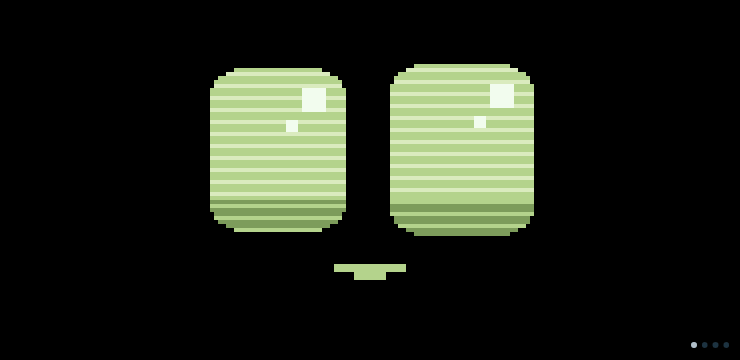
</p>
<p align="center"><b>Pick any accent colour</b> and Chip's whole look follows it:</p>
<p align="center">
  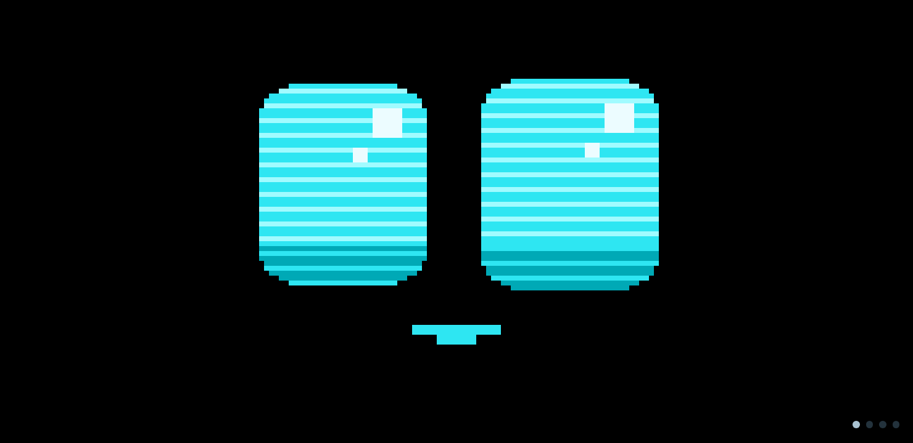
  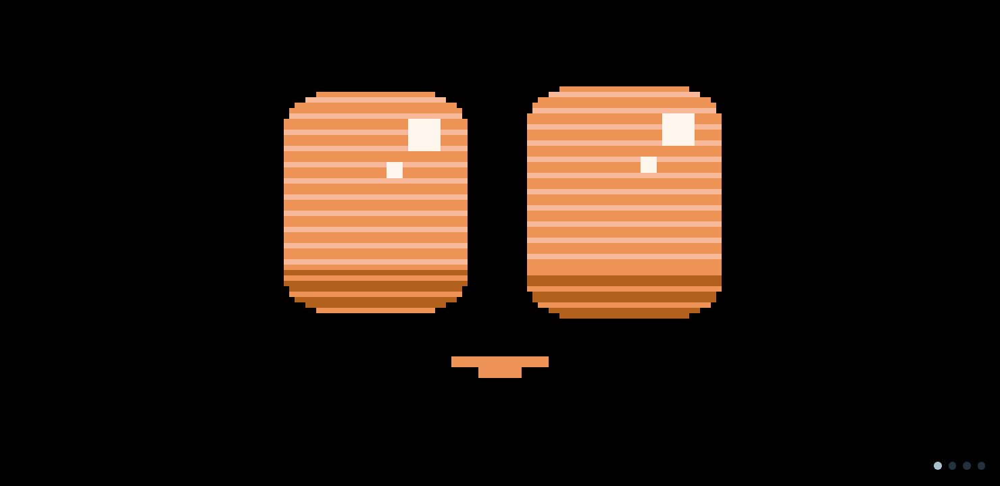
  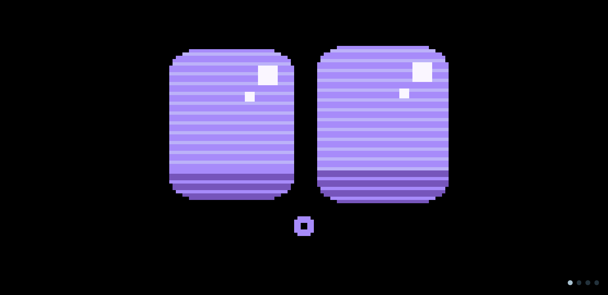
  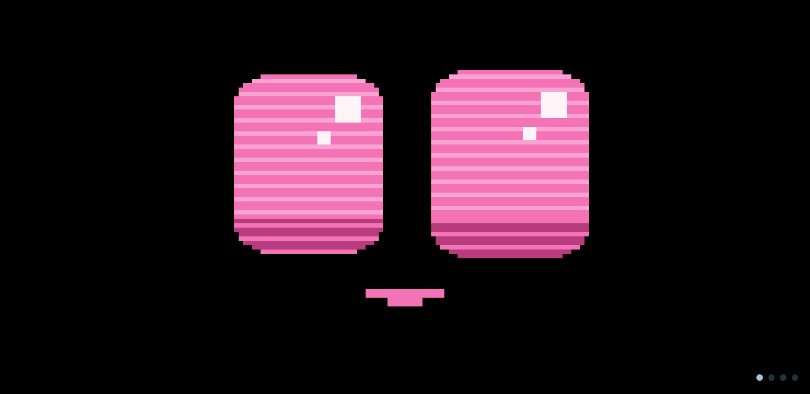
</p>

<p align="center"><b>Three eye styles:</b> Classic (above), Toon and Button.</p>

<p align="center">
  
  
</p>

**Custom skins**, made with an AI chatbot in a few minutes (fan-made examples, not included in the repo):

<p align="center">
  
  
  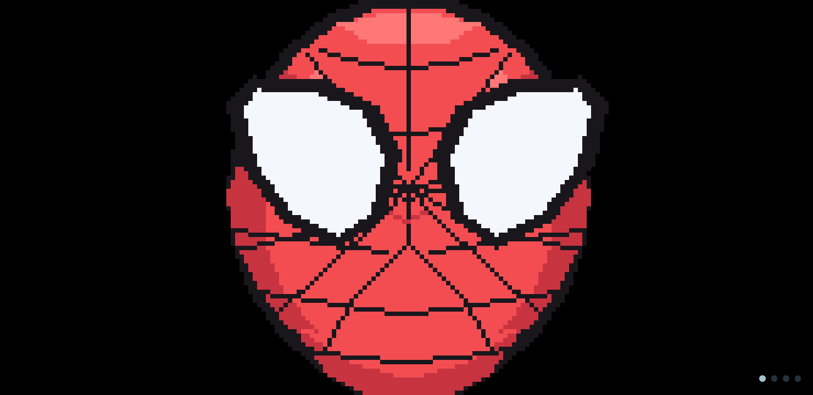
</p>

## Gallery

<table>
  <tr>
    <th width="60%">Typing along / focus mode</th>
    <th width="40%">Music visualizer</th>
  </tr>
  <tr>
    <td>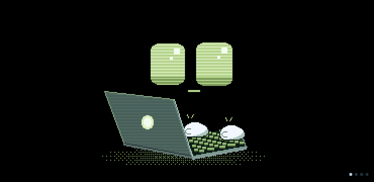</td>
    <td>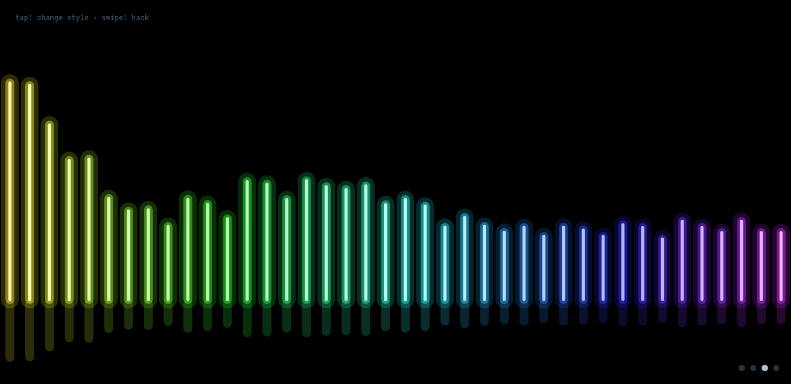</td>
  </tr>
</table>

| Clock & weather | Laptop stats and music |
|---|---|
| 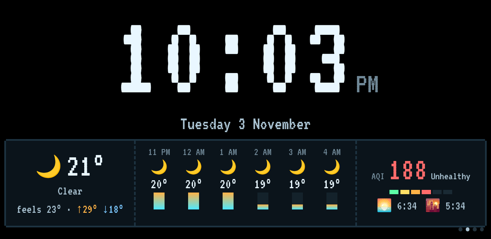 | 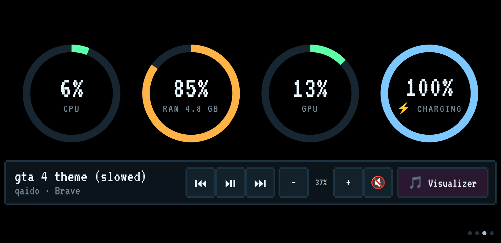 |

| Pomodoro timer | Headphones while music plays |
|---|---|
| 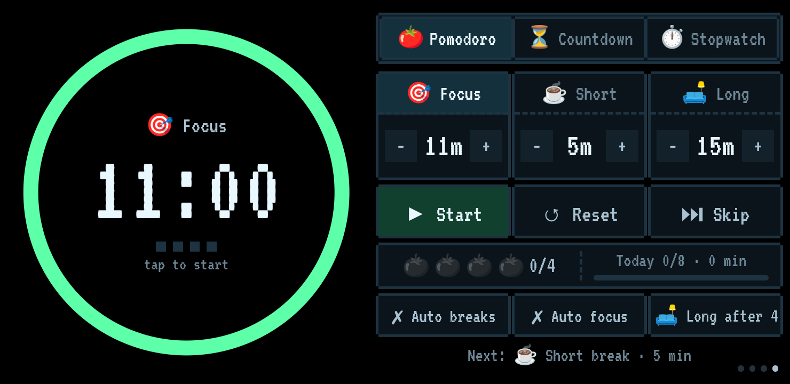 | 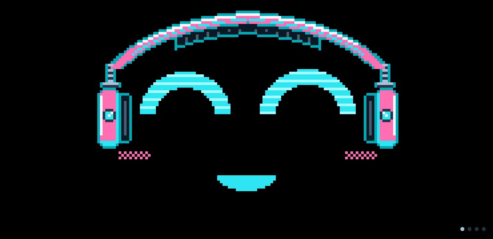 |

**Music visualizer, 7 styles** (tap the screen to switch): bars, mirror, radial, neon, waves, LED and silk.

<p align="center">
  
  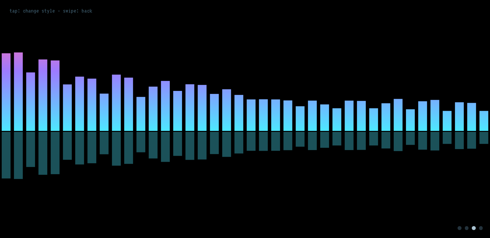
</p>
<p align="center">
  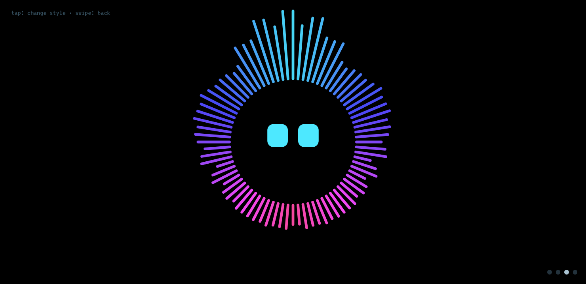
  
</p>
<p align="center">
  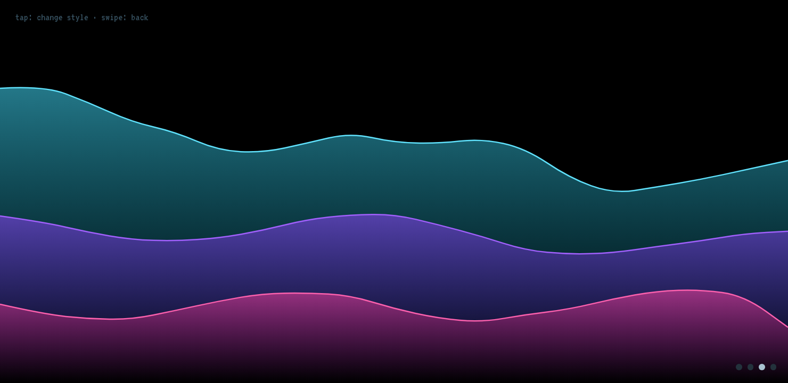
  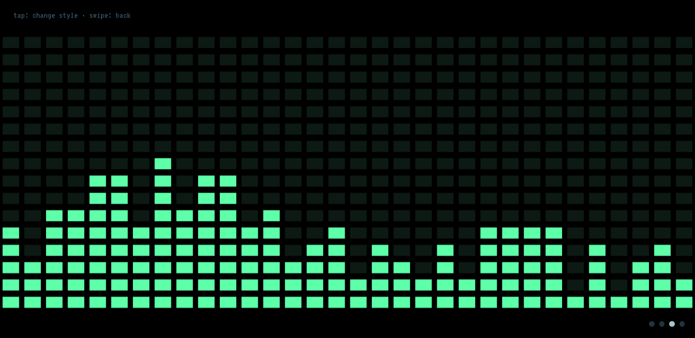
  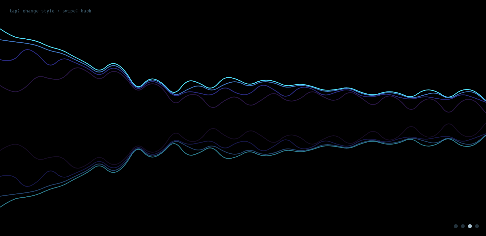
</p>

**The dashboard** on the laptop, with a page for every setting:

<p align="center">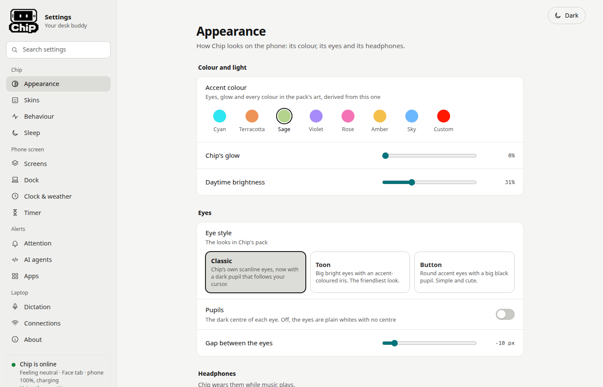</p>

## Why you'll love it
- 🫶 **It's alive.** Chip blinks, looks around, whistles, sneezes, peeks off-screen, spins, yawns and dozes off when
  you leave. Tap it, rub it, poke it, shake it: it reacts to each one differently.
- ⌨️ **It works with you.** Start typing and Chip opens its own little laptop and types at your speed, sparks fly
  above 60 wpm, and it hits a big Enter when you stop. During a focus session the room goes dark and Chip codes by moonlight.
- 🎙️ **Talk instead of type.** Hold Chip's face with two fingers, speak, let go: your words appear wherever your cursor
  is on the laptop. Offline on the phone, offline on the laptop, or via Groq, OpenAI, Deepgram, Gemini and more.
  Speaks Hinglish out of the box.
- 🤖 **Your AI agents' pager.** When Claude Code, Gemini CLI or opencode finishes or needs you, the phone flashes its
  torch, plays a chime and Chip tells you who's calling. One click on the dashboard sets the hooks up.
- 🎧 **It vibes to your music.** Headphones on when music plays, bobbing to the beat, a music card with play/pause,
  next and volume, and a full-screen visualizer with 7 styles (bars, mirror, radial, neon, waves, LED, silk).
- 🍅 **A Pomodoro timer you'll actually see.** Pomodoro, countdown and stopwatch with a giant ring, daily goals,
  auto-start breaks, and star eyes when you finish a focus session.
- 📊 **Your laptop at a glance.** CPU, RAM, GPU and battery rings, plus a big clock, hourly weather, air quality,
  sunrise and sunset. Chip wears a mask when the air is bad.
- 🎨 **Make it yours.** 8 accent colours or any colour you pick, 3 eye styles, and **custom skins**: describe your pet,
  yourself or a character to any AI chatbot, upload what it gives you, and Chip becomes that face.
- 👀 **Its eyes follow your mouse** across all your monitors (Linux/GNOME).
- 🌙 **It keeps you healthy.** Reminds you to stretch after 50 minutes, warns when the laptop battery is low, says the
  hour, greets you in the morning and goes to sleep at night.
- 🔒 **Private by design.** Everything stays on your Wi-Fi. Notifications keep only the app's name, typing along only
  counts key presses, and there's no camera, analytics or account.

> **Status: beta.** Linux (GNOME) is the main platform and has every feature. Windows 10 is tested end to end on a
> real PC with a real phone (Windows 11 has the same code but no test yet). macOS support is written but not finished. See the [comparison table](#what-works-where).

---

## Contents
- [All features](#all-features)
- [What works where](#what-works-where)
- [What you need](#what-you-need)
- [Install on the laptop](#1-install-on-the-laptop) — [Linux](#linux-gnome) · [Windows](#windows-1011) · [macOS](#macos-experimental)
- [Set up the phone](#2-set-up-the-phone)
- [Using Chip](#using-chip)
- [Privacy and security](#privacy-and-security)
- [Troubleshooting](#troubleshooting)
- [Updating](#updating)
- [Uninstall](#uninstall)
- [For developers](#for-developers)

---

## All features

**Chip's face**
- Blinks, looks around and reacts: tap = happy, double-tap = hearts, rub back and forth = pets, poke 6× = grumpy,
  shake the phone = dizzy, drag a finger = its eyes follow it.
- 14 idle animations (whistle, sneeze, peek off-screen, spin, wiggle, smirk, yawn, nod off…). Choose which ones play
  and how often.
- Headphones while music plays on the laptop (bring your own pair with a skin), a mask when the air quality index is
  200 or more (tap to take it off for 15 s), star eyes after a focus session.
- A background glow that follows the time of day and Chip's mood.
- Says hello and introduces itself by name, says the hour, can talk (text to speech) and play sounds.
- Sleeps at night (11 PM–6:30 AM by default, you choose), dims the screen, and greets you in the morning.
- Pixel-perfect art at 12 frames per second in the VT323 pixel font with CRT scanlines, tuned to run on a weak phone.
- Rotates with the phone; every screen has a portrait layout.

**Screens** (swipe left/right: Face → Clock & weather → Laptop → Timer)
- **Clock & weather:** big pixel clock, date, current weather, 6-hour forecast, air quality, sunrise and sunset
  (Open-Meteo, no API key). Pick your city on the dashboard.
- **Laptop:** CPU, RAM, GPU and battery rings; music card with the song, play/pause, previous, next, volume and mute.
- **Visualizer:** a cava-style spectrum of whatever the laptop is playing, 7 styles, tap to switch.
- **Timer:** Pomodoro (focus / short / long, long break after N, auto-start, daily goal and today's sessions),
  countdown with presets, stopwatch. The running timer shows as a pill on the face.
- **Swipe up:** app shortcuts and quick toggles (sounds, talking, dictation engine, fast dictation, visualizer, torch,
  reload). **Swipe down** on the face: a quick summary.

**Scenes**
- **Typing along:** after you've typed on the laptop for 10 s, Chip boots its own laptop and types at your pace,
  thinks when you pause, gets an idea when you carry on, bursts into sparks above 60 wpm and hits a big Enter when you stop.
- **Focus mode:** during a focus session the room dims, a moon comes up and Chip works away; it gets into flow when you
  type fast, and notifications show as muted bubbles.

**Dictation**
- Hold Chip's face with two fingers, speak, let go; slide a finger away to cancel. Typed where your cursor is.
- Three engines: **phone** (whisper.cpp, offline), **laptop** (whisper.cpp, offline, under a second), **cloud** (Groq,
  OpenAI, Deepgram, ElevenLabs, AssemblyAI, Google, Azure, Gemini or a custom URL with your own key).
- Hinglish by default, auto-detect, or any Whisper language. Fast mode for quicker, smaller models.
- Never presses Enter, never types while the laptop is locked, the mic is only on while you hold.

**Alerts**
- AI agents: Claude Code, Gemini CLI and opencode hooks, installed and removed from the dashboard.
- Other apps' notifications (Linux): choose which apps count and whether they get torch, sound, both or nothing.
- Torch blinking and/or a sound (chime, beep, alarm, ping), reminders every N seconds until you're back, "only when
  I'm away" and night settings, a test button and the last alerts.
- Torch also blinks when a focus session or break ends, for the countdown alarm, at stretch time and for laptop
  battery or heat warnings. Plus a flashlight button.

**Make it yours**
- Accent colour: cyan, terracotta, sage, violet, rose, amber, sky, or any colour; the whole palette follows it.
- Eye styles: Classic, Toon, Button, with S/M/L pupils and a gap setting.
- Custom skins made with any AI chatbot, checked and previewed on the dashboard, with optional matching headphones.
  Rename Chip too: a skin's name is what it calls itself.
- Choose which screens, dock items, clock and laptop panels show.

**On the laptop**
- **Dashboard** at <http://127.0.0.1:8765> with a page per topic, light and dark theme, and search. Changes reach the
  phone within ~3 seconds.
- **Connections page:** link status, reconnect, find the phone, pair a new one, forget it, and a built-in doctor.
- The link heals itself: if the phone's IP changes it finds it again, and after a reboot of either side it comes back
  within a minute. When you update the Chip folder, the phone gets the new files automatically.

---

## What works where

Everything on the phone itself (face, reactions, clock, weather, timers, skins, sounds, torch) works the same with
every laptop. The differences are in what the laptop can report or do:

| Feature | Linux (GNOME) | Windows 10/11 | macOS 14+ |
|---|:---:|:---:|:---:|
| Wi-Fi link, pairing wizard, auto-reconnect, auto-update of the phone | ✅ | ✅ | 🧪 |
| Dashboard (all settings) | ✅ | ✅ | 🧪 |
| Start automatically at login / boot | ✅ systemd (at boot) | ✅ at login | 🧪 LaunchAgent |
| CPU, RAM, uptime, network | ✅ | ✅ | 🧪 |
| Laptop battery | ✅ | ✅ (code only: the test PC had no battery) | 🧪 |
| GPU ring | ✅ (AMD) | ❌ | ❌ |
| Temperatures and fan | ✅ | ❌ | ❌ |
| Dictation typed into the focused window | ✅ | ✅ | 🧪 (needs Accessibility) |
| Dictation engine: phone (offline) | ✅ | ✅ | ✅ |
| Dictation engine: cloud | ✅ | ✅ | ✅ |
| Dictation engine: laptop (offline whisper.cpp) | ✅ | ✅ `Install Chip.cmd --stt` downloads it | ✅ `install.py --stt` (Homebrew) |
| Knows when you're idle or the screen is locked | ✅ | ✅ (Windows 10 lock screen proven) | 🧪 |
| AI-agent alerts (Claude Code, Gemini CLI, opencode) | ✅ | ✅ (Claude Code hooks tested from cmd, PowerShell and Git Bash) | 🧪 |
| Alerts for other apps' notifications | ✅ | ❌ | ❌ |
| Music card: now playing, play/pause, next | ✅ | ✅ (read from Windows' media sessions) | ❌ |
| Volume control | ✅ | ❌ | ❌ |
| Music visualizer | ✅ | ❌ | ❌ |
| Headphones on Chip while music plays | ✅ | ✅ | ❌ |
| Chip types along with you | ✅ | ✅ (counts key presses only) | ❌ |
| Eyes follow the mouse pointer | ✅ (GNOME extension) | ❌ | ❌ |
| "Only connect on my home Wi-Fi" | ✅ | ✅ | ⚠️ macOS may hide the Wi-Fi name |
| Custom skins | ✅ | ✅ (needs Node.js) | ✅ (needs Node.js) |

✅ works · ⚠️ works with an extra step · 🧪 written, not proven yet · ❌ not yet (the dashboard greys it out and says so)

Linux was built and tested on Ubuntu with GNOME on Wayland. Other desktops will get the basics (stats, link, phone
features), but idle/lock, media, notifications, typing and eye tracking use GNOME's D-Bus APIs.

---

## What you need

**A laptop** running one of:
- **Linux** with GNOME (Ubuntu 24.04+ recommended), Python 3.12+, `ssh` (openssh-client), `git`
- **Windows 10 or 11**. `Install Chip.cmd` gets Python 3.12+ from python.org for you if it's missing (the Microsoft
  Store Python doesn't work for Chip). Windows' built-in OpenSSH client is used.
- **macOS 14+** (experimental) with Python 3.12+ from python.org or Homebrew

Optional: [Node.js](https://nodejs.org/) 18+ for custom skins.

**An Android phone, your own or a spare one.** It needs **Android 7 or newer** (Termux only supports Android 7+).
Chip is light: it was tested on a Samsung Galaxy M01 Core, a very weak Android Go phone, so almost anything works.
You need these free apps from **[F-Droid](https://f-droid.org/)**:
- [Termux](https://f-droid.org/packages/com.termux/) — runs Chip's small server on the phone
- [Termux:API](https://f-droid.org/packages/com.termux.api/) — battery, torch and voice
- Optional, for a phone that stays on the desk all the time:
  [Termux:Boot](https://f-droid.org/packages/com.termux.boot/) (start Chip when the phone boots) and
  kiFOSSk (a kiosk launcher that makes Chip the home screen)

> Install Termux and Termux:API **from the same place (F-Droid)**. Mixing F-Droid and Play Store versions breaks them,
> and the Play Store Termux is outdated.

**Both on the same Wi-Fi.** Some routers (guest networks, office Wi-Fi) stop devices from seeing each other; if pairing
can't find the phone, use a home network or the phone's own hotspot.

---

## 1. Install on the laptop

First get the code, either with git or with GitHub's **Code → Download ZIP** (then unzip it somewhere permanent;
Chip runs from that folder, so don't delete it afterwards):

```bash
git clone https://github.com/Shriaman2005/deskbuddy.git
cd deskbuddy
```

### Linux (GNOME)

```bash
laptop/install.sh
```

This installs the bridge as a systemd user service (`deskbuddy-bridge`) that starts at boot, even before you log in,
and links the small GNOME Shell extension that lets Chip's eyes follow your mouse. **Log out and back in once** so
GNOME loads the extension.

Then open the dashboard: <http://127.0.0.1:8765>

Optional extras:
- Music visualizer and volume need PipeWire/PulseAudio tools (`wpctl`, `parec`), which Ubuntu has by default.
- Offline dictation on the laptop: build [whisper.cpp](https://github.com/ggml-org/whisper.cpp) and put `whisper-cli`
  and a model (e.g. `ggml-base-q8_0.bin` in `models/`) in `~/.local/share/deskbuddy/stt/`. The dashboard's Dictation
  page shows whether it was found.

### Windows 10/11

1. Get the Chip folder: on GitHub click **Code → Download ZIP**, then right-click the ZIP in Downloads and choose
   **Extract All… → Extract** (or git clone, see above). With a ZIP the folder is `deskbuddy-main` inside
   `deskbuddy-main`: use the inner one, the one that has `Install Chip.cmd`.
2. Double-click **`Install Chip.cmd`**. If Windows says the publisher could not be verified, click **Run**.
3. Wait about a minute. If Python 3.12+ isn't installed, it installs Python 3.14 from python.org with winget, just for
   your Windows user (no admin, no UAC). Then it creates a private Python environment and Chip's own ssh key, fetches
   Node.js for skins, sets Chip to start when you sign in, starts it and opens the dashboard. (The first time Edge
   opens, it shows its own welcome screen first.)
4. In the dashboard open **Connections → Add phone**. If Windows asks whether to allow Python on the network, choose
   **Allow** on **private networks**. If it doesn't ask and the phone can't download, the wizard shows one
   `netsh` command to paste into an administrator terminal (and the command that undoes it).

Running `Install Chip.cmd` again updates or repairs Chip; it also moves Chip to a new folder if you run it from a
newer download. From a terminal: `"Install Chip.cmd" --uninstall` or `--repair` (the same options as `laptop\install.py`).
Logs are in `%USERPROFILE%\.local\share\deskbuddy\bridge.log`.

**Tested on:** Windows 10 Pro 22H2 (build 19045), a desktop PC (Ryzen 5, wired network, no battery), a standard
(non-admin) account, Python 3.14 and 3.15, Microsoft Edge, a phone running Termux with OpenSSH 10.6; reboot and sign-in,
a killed bridge (back in about 8 s), pairing, auto-deploy, typing along, music, skins and dictation. CI also runs
Windows Server's `windows-latest` on every push.
**Not tested yet:** Windows 11, a laptop (battery, Wi-Fi name, sleep and resume), a Chip folder on a drive without 8.3
short names, the phone's own (offline) dictation engine, and the music card on the phone with real music.

Known limits on Windows:
- Dictation can't type into a window that runs **as administrator** (Windows blocks this). Chip answers "The window in
  front is running as administrator" instead of typing; click a normal window first. It also won't type while the PC is
  locked.
- Chip runs when you are signed in (it starts at sign-in, not at boot) and only in your own Windows user.
- No GPU ring, temperatures or fan, other apps' notifications, volume control, music visualizer, headphones while music
  plays, or eyes following the mouse (all ❌ in the table above; the dashboard says so).
- Custom skins need Node.js; the installer fetches it itself (checksummed). Without it the Skins page says so.
- Offline dictation on the laptop: run `"Install Chip.cmd" --stt` in a terminal in the Chip folder. It downloads
  whisper-cli.exe and the small and base models (about 300 MB, checksummed, safe to repeat) into
  `%USERPROFILE%\.local\share\deskbuddy\stt\`. Short sentences take about a second. A `whisper-cli.exe` on your PATH
  also works. The phone and cloud engines work without it.
- If the phone's Termux keeps stopping (Android kills it), give Termux, Termux:Boot and the kiosk app **Unrestricted**
  battery use and run `termux-wake-lock`.
- Don't use the Microsoft Store Python: Chip skips it and installs the python.org one next to it.

### macOS (experimental)

macOS support is written but hasn't passed its tests yet. If you want to try it:

```bash
python3 laptop/install.py
```

Use Python 3.12+ from python.org or Homebrew (the one that comes with Xcode is too old). The installer adds a
LaunchAgent so Chip starts at login, and opens **System Settings → Privacy & Security → Accessibility**: allow the
**Python** it names there, otherwise dictation can't type. It also shows that Python.app selected in Finder: drag it
into the Accessibility list and switch it on. Log: `~/Library/Logs/deskbuddy-bridge.log`.
Offline dictation on the laptop: `python3 laptop/install.py --stt` installs Homebrew's `whisper-cpp` (if it isn't
there yet), links its `whisper-cli` into `~/.local/share/deskbuddy/stt/` and downloads the small and base models
(about 300 MB, checksummed, safe to repeat). Needs [Homebrew](https://brew.sh). Chip picks it up within 30 s.
Please open an issue with what you see.

---

## 2. Set up the phone

Pairing is done from the dashboard and takes about 5 minutes (most of it is Termux installing packages).

1. On the phone, install **Termux** and **Termux:API** from F-Droid and open Termux once.
2. On the laptop, open the dashboard → **Connections** → **Add phone** → **Start pairing**.
3. The dashboard shows a one-line command. Type it into Termux on the phone (it downloads the setup from your laptop,
   checks it, installs what's needed and starts Chip's server). The download is open for 10 minutes and only for one phone.
4. When it finishes, the phone prints a **PAIRING CODE** (4 groups of 4 characters). Type it into the dashboard and
   press **Pin this phone**. Nothing is trusted until you do this.
5. On the phone, give these permissions in **Settings → Apps** (the setup script lists them too):
   - Termux → **Microphone** (for dictation)
   - Termux → **Notifications: allowed**
   - Termux → **Battery: Unrestricted** (otherwise Android closes the connection when the screen is off)
   - Termux:API → **Modify system settings** — only on a phone that's dedicated to Chip, so Chip can control brightness

Now show Chip's face. Pick one:

**A phone you also use (personal phone)**
- Open `http://127.0.0.1:8080` in Chrome, then ⋮ → **Install app** (or **Add to Home screen**). Chip then opens full
  screen and keeps the screen on while it's showing.
- Turn on **Personal phone** on the dashboard's Connections page.
- Chip runs while Termux runs: open Termux (or type `chip-start`) to start it; type `chip-stop`, or tap **Exit** in
  Termux's notification, to stop it. `chip-restart` restarts it and keeps the connection; the dashboard's Connections
  page has the same as **Restart Chip on the phone**, **Stop Chip on the phone** and **Start Chip when the phone starts**.

**A spare phone that lives on the desk (always on)**
- Install **Termux:Boot** (F-Droid) and open it once, so Chip starts by itself when the phone reboots.
- Install **kiFOSSk**, set it as the home app, and point it at `http://127.0.0.1:8080`. Set its orientation to
  Auto-rotate if you like; every screen has a portrait layout.
- Set Termux, Termux:Boot and kiFOSSk to **Battery: Unrestricted** (Android Go phones kill them otherwise).
- Long-press anywhere with one finger to reach kiFOSSk's own settings ("Switch to different launcher" gives you the
  normal home screen back).

**Optional: offline dictation on the phone.** In Termux run `bash ~/deskbuddy/stt-setup.sh`. It builds whisper.cpp
on the phone (about 10 minutes) and downloads a small model. Without it, use the laptop or cloud engine.

From now on everything is automatic: when the laptop or phone restarts, the link comes back by itself within a minute,
and when you update the Chip folder on the laptop, the phone gets the new files the next time it connects.

---

## Using Chip

### Gestures on the phone
| Gesture | What happens |
|---|---|
| Swipe left / right | Face → Clock & weather → Laptop → Timer |
| Swipe up | Apps and quick toggles (sounds, talking, dictation engine, torch, reload) |
| Swipe down on the face | Quick summary |
| Tap / double-tap | Happy / hearts |
| Rub back and forth | Pets |
| Poke 6 times | Grumpy |
| Shake the phone | Dizzy |
| Hold with **two fingers**, speak, let go | Dictation (slide a finger away before letting go to cancel) |
| Tap the timer pill on the face | Opens the running timer |

### Dictation
Pick the engine on the dashboard (**Dictation** page) or from the swipe-up drawer:
- **Phone:** whisper.cpp on the phone, fully offline (needs `stt-setup.sh`). About 6 seconds for a sentence on a weak
  phone, 3 seconds in Fast mode.
- **Laptop:** whisper.cpp on the laptop, offline, under a second. The audio is sent through the tunnel and stays in memory.
- **Cloud:** a provider you choose. Paste your API key on the dashboard; it's stored only in
  `~/.config/deskbuddy/secrets.json` on the laptop, never sent to the phone, never shown again (only the last 4 characters).

Safety rules that are always on: Chip never presses Enter, never types while the laptop is locked, the mic is only on
while you hold, and only the paired phone can trigger typing. If the engine fails, nothing is typed and Chip says why.

### AI agents
Dashboard → **AI agents** installs the hooks for **Claude Code**, **Gemini CLI** and **opencode** with one click (and
removes them again). It edits their settings files and keeps a `.chip-bak` backup the first time. Use **Test** to see
the alert on the phone. The **Attention** page sets torch/sound, reminders, "only when I'm away" and night mode;
the **Apps** page sets it per app.

### Make your own Chip
A skin changes Chip's eyes, mouth, face plate, ears, headphones and colours. Its animations stay the same.
1. Dashboard → **Skins** → pick what it's based on (your pet, yourself, a character, your art, or just an idea) and
   copy the prompt into any AI chat (ChatGPT, Gemini, Claude…), with your pictures attached there.
2. Save the JSON the chat gives you and upload it (or paste it).
3. If it has problems, the page lists each one; **Copy message for your AI** gives you a reply that asks the chatbot
   to fix exactly those. When it passes, you see a live preview; **Use on Chip** installs it.

Only the JSON file reaches the laptop, never your pictures. Skins need Node.js on the laptop.

---

## Connections and reboots

Everything below is on the dashboard's **Connections** page (<http://127.0.0.1:8765/#connections>). Windows commands
use `py -3` instead of `python3` and `laptop\chip.py` for the path.

**Keep the manual.** Press **Download the manual** at the top of the Connections page. It is one page, made for your
laptop's system (Windows, macOS or Linux), with the commands to copy and paste to start, stop or set up Chip again, for
when the dashboard can't open (after a reboot with start-at-login off, or after you close Chip). The dashboard offers it
again after you add a phone and when you switch start-at-login off.

**Switch between phones you paired before**
1. Open **Your phones**. Every phone you paired with the code is listed.
2. Get that phone ready (next section), then press **Switch to this phone**. No new code is needed.
3. If it says "key mismatch", Termux was reset on that phone: press **Pair again** and follow the wizard.
4. **Remove...** deletes a saved phone; **Disconnect this phone...** (under Add phone) stops the link but keeps it saved.

**Get the phone ready to connect**
1. Same Wi-Fi as the laptop.
2. Open Termux (Chip starts by itself), or type `chip-start`.
3. Leave Termux in the background and set its battery to **Unrestricted**.
4. Press **Switch to this phone** (or **Reconnect**).

**Restart Chip on the phone**
1. Press **Restart Chip on the phone** (the connection stays up). Or, in Termux on the phone: `chip-restart`.
2. **Stop Chip on the phone...** (or `chip-stop`) also stops the phone's ssh server, so the laptop can't start it
   again: open Termux on the phone and type `chip-start`.

**Stop and start Chip on the laptop**
1. Press **Stop Chip...** on the **This laptop** card, or in a terminal: `python3 laptop/chip.py stop`.
   The dashboard closes with it, and the phone shows nothing until Chip runs again.
2. Start it again: `python3 laptop/chip.py start`. Also: `restart`, `status`.

**Don't start Chip by itself**
1. Laptop: switch off **Start Chip when the laptop starts**, or `python3 laptop/chip.py autostart off` (`on` to undo).
   After that, start it by hand with `python3 laptop/chip.py start`. Keep the one-page manual
   for your laptop (**Download the manual** at the top of the Connections page, or `docs/manual/` for
   [Windows](docs/manual/chip-manual-windows.pdf), [macOS](docs/manual/chip-manual-macos.pdf),
   [Linux](docs/manual/chip-manual-linux.pdf)): every command to copy and paste, for when the dashboard can't open.
2. Phone: switch off **Start Chip when the phone starts** (it needs Termux:Boot). Then Chip starts when you open
   Termux, or when you type `chip-start`.

**Set up again**
1. Phone (after a Termux reset, or when packages broke): press **Set up again** on that phone in **Your phones**.
   It opens the Add phone wizard: run the command it shows in Termux, then type the code the phone prints.
2. Laptop: Windows `py -3 laptop\install.py --repair`, macOS `python3 laptop/install.py --repair`. It builds the venv
   again and restarts Chip; your settings, Chip's ssh key, saved phones and the start-at-login choice stay.
3. Linux: run `laptop/install.sh` again. It only rewrites the service and keeps your settings, key and phones.

---

## Privacy and security

- **Nothing leaves your home network** except weather/air-quality lookups (Open-Meteo, by city coordinates), the daily
  update check (one anonymous request to GitHub; switch it off on the About page) and, only if you choose the cloud
  dictation engine, the audio clip to that provider.
- **The link** is ssh with keys only: the laptop opens one tunnel to Termux's sshd (port 8022) and pins the phone's
  host key, so another device can't pretend to be your phone, even if it takes over its IP address. Passwords,
  agent/X11 forwarding and port forwards into the phone are switched off in the phone's sshd config.
- **The bridge** listens only on `127.0.0.1:8765`. Only the dashboard (origin `http://127.0.0.1:8765`) can change link
  settings or pair a phone; web pages and the phone's page can't. The only port opened to the network is the
  10-minute pairing download.
- **Safe on your own phone.** Chip only uses the battery level, the Wi-Fi signal, the torch (for alerts) and, while you
  hold the face to dictate, the microphone. It never reads your photos, messages, contacts or other apps, and never uses
  the camera. It runs inside Termux's own sandbox, and with **Personal phone** switched on it never changes your
  screen brightness.
- **Notifications:** only the sending app's name is kept, never the content. **Typing along** counts key presses,
  never which keys. **Eye tracking** reads only the pointer position while it's on. No webcam, no analytics.
- Your settings, keys and data live in `~/.config/deskbuddy/` and `~/.local/share/deskbuddy/` (the same folders on
  Windows and macOS, under your user folder). They're never in the repo.

---

## Troubleshooting

Run the doctor first. It checks every link and says what to do:
```bash
python3 -I laptop/doctor.py        # Windows: py -3 -I laptop\doctor.py
```
The dashboard's **Connections** page has a **Doctor** button too, and shows why the phone is offline.

| Problem | Fix |
|---|---|
| Pairing: the phone can't download the setup | Allow Python through the firewall (private networks). On Linux the wizard shows the exact `ufw` command to allow it for this pairing only. |
| Pairing: the laptop can't find the phone | Both must be on the same Wi-Fi. Guest/office networks often isolate devices: use your home Wi-Fi or the phone's hotspot. |
| Chip goes offline when the phone screen turns off | Set Termux (and Termux:Boot, kiFOSSk) to **Battery: Unrestricted**. |
| Torch, battery or voice don't work | Termux:API must be installed from F-Droid, like Termux, and opened once. Check with `termux-battery-status` in Termux. |
| Red "Termux:API Error: Connection refused" notification | Termux:API woke too slowly (common on Android 14+). Open it once, set its battery to **Unrestricted**, allow its permissions, run `pkg upgrade termux-api`. Harmless otherwise. The dashboard's **Troubleshooting** page lists every error with its fix. |
| "Key mismatch" on the Connections page | Something else answers at the phone's address, or Termux was reinstalled. Press **Set up again** (or **Pair again**) on that phone and type the new code. |
| Dictation types nothing (Windows) | The focused window may be running as administrator. Click a normal window. |
| Dictation types nothing (macOS) | Allow the Python the installer named in **Accessibility**. |
| A feature is greyed out with "Linux only for now" | It isn't available on your OS yet (see the [table](#what-works-where)). |
| Eyes don't follow the mouse (Linux) | Log out and back in once after installing; `doctor.py` tells you if the extension is off. |

One phone pairs with one laptop at a time. Pairing a new laptop replaces the old one's key on the phone.

---

## Updating

Once a day the laptop checks GitHub for a new release of Chip. When there is one, the dashboard shows a banner and
**About → Updates** shows what's new; Chip also says so on the phone (switch that off with **Chip mentions updates**,
or the whole check with **Check for updates**).

- **Installed with `git clone`:** press **Update now**. Chip pulls the release, restarts the bridge, and the phone
  gets the new files by itself when it reconnects. It refuses if you've edited files in the Chip folder, so your
  changes are never overwritten.
- **Installed from a ZIP:** press **Update now** too (from 1.3.4 on). Chip downloads the release's ZIP from
  GitHub, checks it, puts the new files into the same folder and restarts. Your settings, skins and paired phone are
  kept (they live outside the Chip folder). Coming from 1.3.3 or older, or if the folder can't be written: press
  **Download**, unzip the new version over the old folder and run the installer again.

## Uninstall

- **Windows / macOS:** `py -3 laptop\install.py --uninstall` (macOS: `python3 laptop/install.py --uninstall`). This
  stops Chip and removes it from login; your settings stay in `~/.config/deskbuddy` and `~/.local/share/deskbuddy`
  (delete those folders to remove everything).
- **Linux:** `systemctl --user disable --now deskbuddy-bridge`, then delete
  `~/.config/systemd/user/deskbuddy-bridge.service` and the settings folders above.
- **Phone:** `chip-stop` in Termux, then uninstall the apps (or delete `~/deskbuddy` in Termux).
- **AI agent hooks:** remove them on the dashboard's **AI agents** page before uninstalling.

---

## For developers

### How it fits together
```
 Phone (Termux)                                     Laptop
 ┌────────────────────────────┐   ssh -R 8765    ┌──────────────────────────────────┐
 │ face page  127.0.0.1:8080  │ ◄──────────────► │ bridge.py  127.0.0.1:8765        │
 │ server.py  (page, torch,   │  one tunnel over │  stats, typing, dictation,       │
 │   speech, dictation)       │   home Wi-Fi     │  settings, dashboard, link       │
 │ sshd :8022 (keys only)     │                  │ platforms/{linux,windows,macos}  │
 └────────────────────────────┘                  └──────────────────────────────────┘
```

| Path | What it is |
|---|---|
| `phone/www/` | The face and screens (HTML/CSS/JS). `pack.json` holds all of Chip's art and motion; `chip.js` is its state machine, `player.js` draws it. |
| `phone/server.py`, `alert.py`, `dictation.py` | Termux side: serves the page, torch and sounds, records and transcribes the mic. |
| `phone/setup.sh`, `services.sh`, `supervisor.sh` | One-time Termux setup (run by pairing) and the services that keep sshd and the server alive. |
| `laptop/bridge.py` | The bridge service: stats, media, typing, dictation, settings, dashboard. |
| `laptop/link.py`, `sshlink.py`, `deploy.py` | The Wi-Fi ssh tunnel, pairing, key pinning, and auto-deploy of `phone/` to the phone. |
| `laptop/platforms/` | Everything OS-specific: `linux.py` (GNOME), `windows.py`, `macos.py`. |
| `laptop/dashboard.html` | The settings dashboard. |
| `laptop/install.sh`, `install.py`, `supervise.py` | Installers (Linux / Windows + macOS) and the Windows restart-on-crash supervisor. `Install Chip.cmd` (top folder) is the Windows double-click wrapper: Python via winget, then install.py. |
| `laptop/doctor.py` | Health check for every link. |
| `laptop/hooks.py`, `attention.py` | AI-agent hooks and the alert they send. |
| `laptop/skin.js`, `merge_pack.js` | Skin checker / prompt generator, and the pack merge tool. |
| `laptop/gnome-extension/` | The GNOME Shell extension for the mouse pointer. |
| `design/` | Design deltas and tools for the art pack. |

### Useful commands
```bash
./deploy.sh                                   # push phone/ to the phone now (it also happens automatically)
systemctl --user restart deskbuddy-bridge     # after editing bridge.py (Linux)
python3 -I laptop/selftest.py                 # throwaway bridge, checks routes and capabilities
python3 -I laptop/test_skins.py               # skin checker tests
node laptop/check_pack.js                     # art pack check
CHIP_FAKE_CAPS=gpu=0,media=0 python3 -I laptop/selftest.py   # pretend a feature is missing
```
Preview the phone page without a phone (bridge running):
`http://127.0.0.1:8765/preview/index.html?screen=0&typing` — also `mood=focus`, `&accent=sage`, `&music`,
`&eyes=toon`, `&skin=<id>`, `&screen=1..3`.

CI (`.github/workflows/ci.yml`) runs the checks on Linux, Windows and macOS on every push, including a fake phone
for the tunnel and real typing into Notepad on Windows.

Contributions and bug reports are welcome: please include the output of `doctor.py`.

---

## Credits and license

Chip's art and animation were designed in Claude Design. Pixel font: VT323. Weather and air quality:
[Open-Meteo](https://open-meteo.com/). Speech: [whisper.cpp](https://github.com/ggml-org/whisper.cpp).

[MIT License](LICENSE) © 2026 Aman Shrivastava
